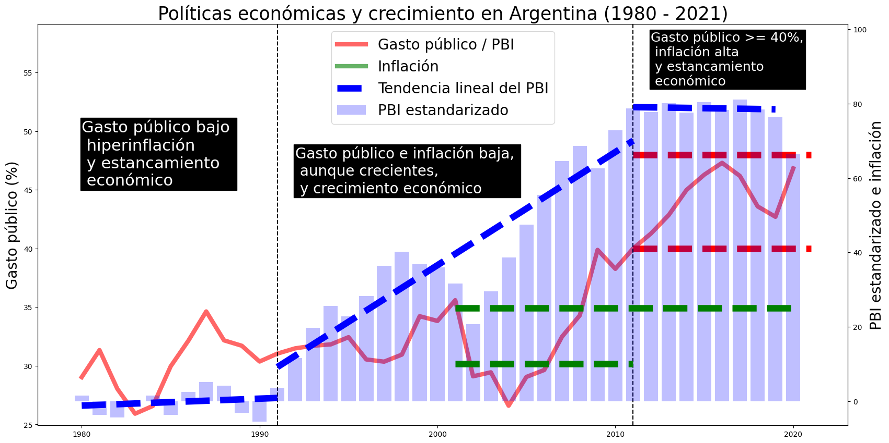
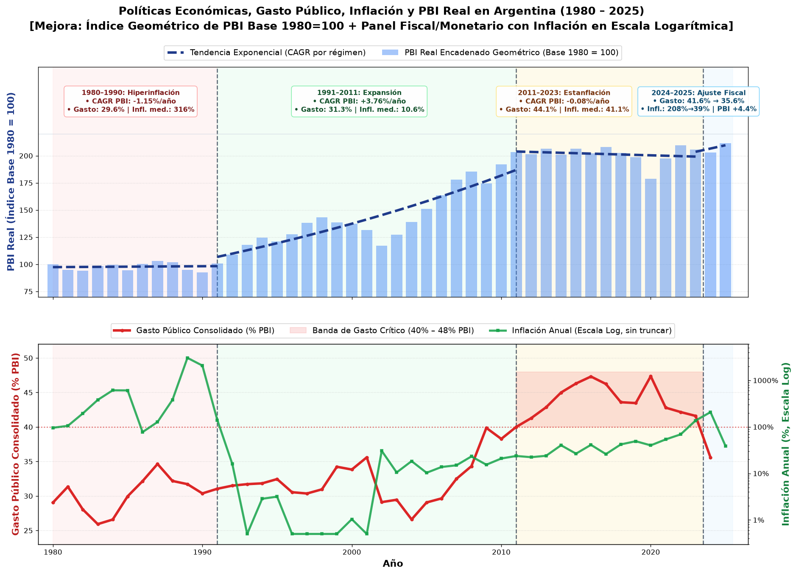
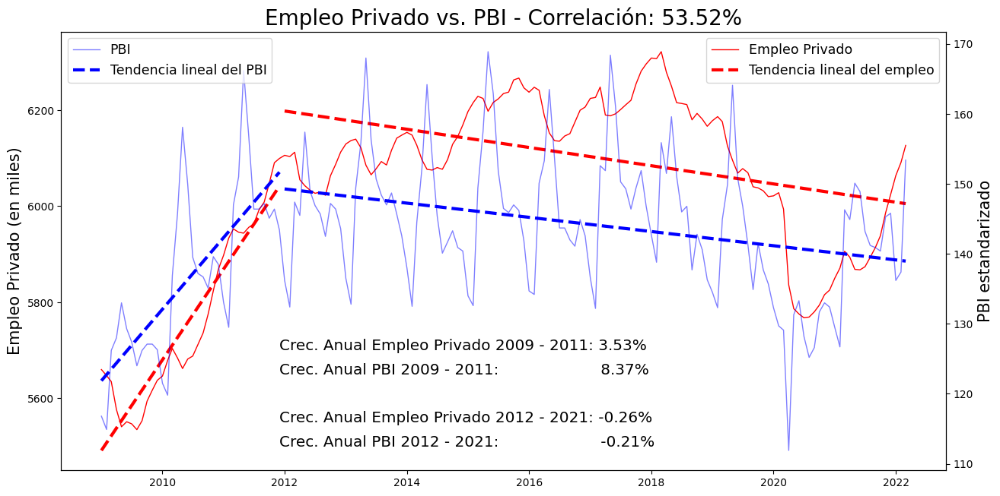
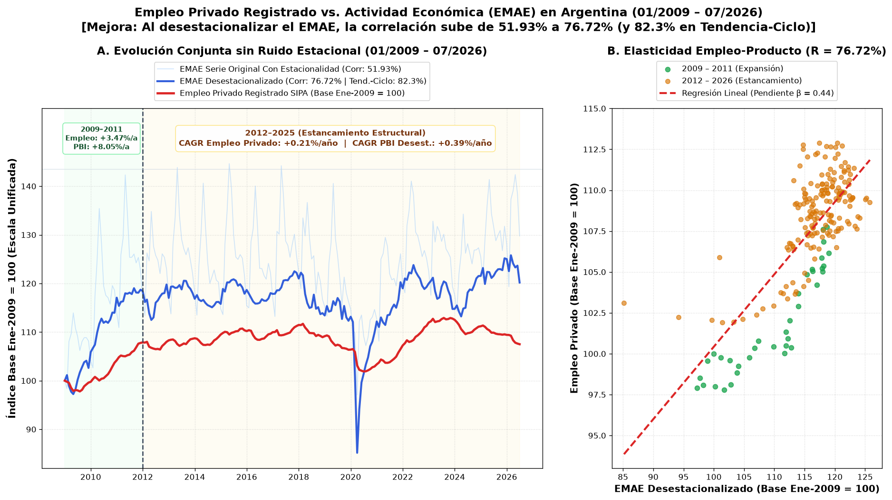
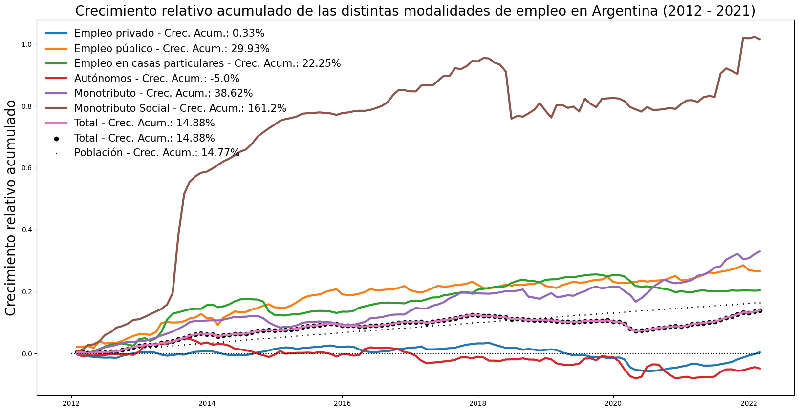
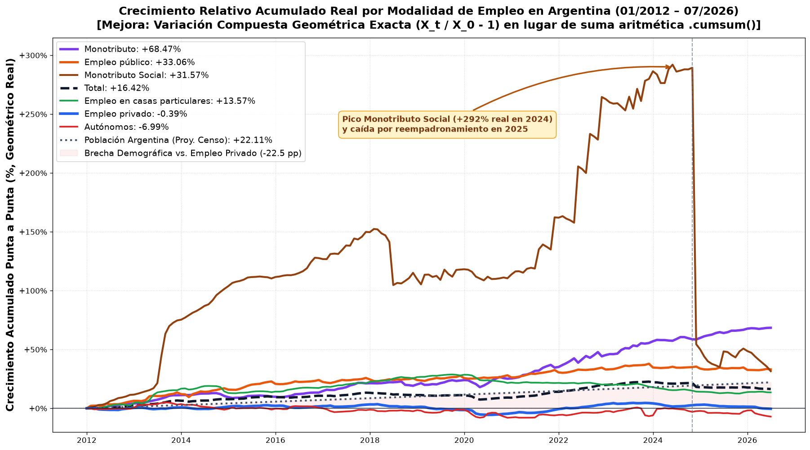
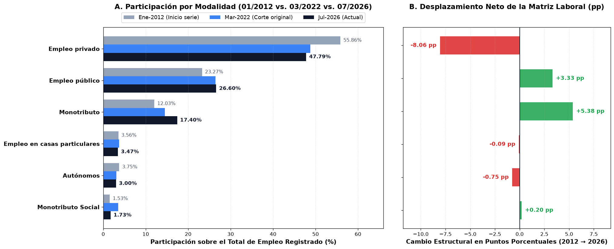
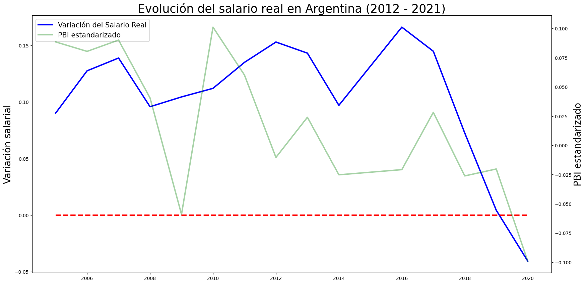
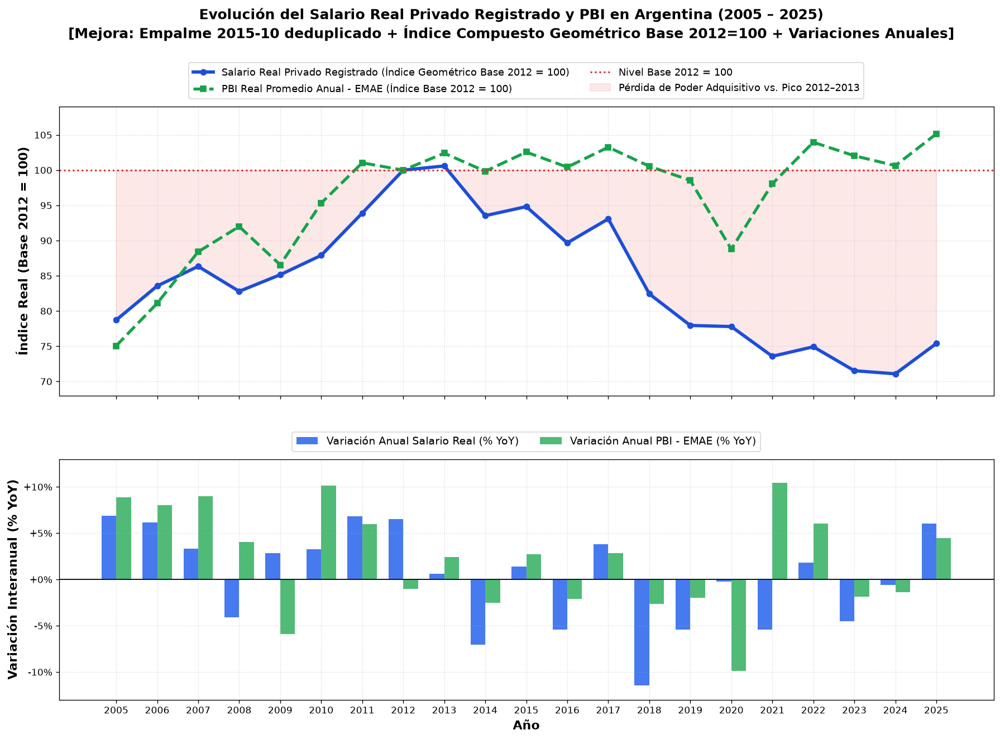

# Auditoría de Visuales, Fuentes y Plan de Sostenibilidad — Sección `Análisis` (`#analisis`)

Documento con:
1. **Resumen de las 7 fuentes oficiales verificadas.**
2. **Comparativa directa por visual:** **(A) Original (`2022`)** vs. **(B) Versión Mejorada y Actualizada (`2026`, sin superposición de leyendas ni comentarios sobre los datos)**.
3. **Plan de Sostenibilidad, Automatización y Arquitectura** para mantener este análisis vivo a lo largo del tiempo.

> **Código fuente histórico:** Guardado en `_legacy/Argentina_Macroeconomia_y_empleo.ipynb` (y `_legacy/macro_n_employment_spanish.ipynb`).

---

## 1. Resumen Ejecutivo de las Fuentes Oficiales (`7/7` Accesibles)

| ID | Serie | Frecuencia | Cobertura Actual | URL Directa / Mecanismo de Descarga (2026) |
| :--- | :--- | :---: | :--- | :--- |
| **(1)** | **Inflación Anual** *(Deflactor PBI)* | Anual | `1961 – 2025` *(65 años)* | `https://api.worldbank.org/v2/en/indicator/NY.GDP.DEFL.KD.ZG?downloadformat=csv` |
| **(2)** | **Crecimiento PBI Real Anual** | Anual | `1961 – 2025` *(65 años)* | `https://api.worldbank.org/v2/en/indicator/NY.GDP.MKTP.KD.ZG?downloadformat=csv` |
| **(3)** | **Gasto Público Consolidado / PBI** | Anual | `1980 – 2024*` *(45 años)* | `https://www.argentina.gob.ar/sites/default/files/gasto_publico_consolidado_desde_1980_2.xls` *(Hoja `% del PIB`)* |
| **(4a)** | **Trabajo Registrado por Modalidad (SIPA)** | Mensual | `01/2012 – 07/2026` *(175 meses)* | `https://www.argentina.gob.ar/sites/default/files/trabajoregistrado_2607_estadisticas.xlsx` *(Hoja `T.2.1`)* |
| **(4b)** | **Empleo Privado por Provincia (SIPA)** | Mensual | `01/2009 – 07/2026` *(211 meses)* | `https://www.argentina.gob.ar/sites/default/files/trabajoregistrado_2607_estadisticas.xlsx` *(Hoja `A.5.1`)* |
| **(5)** | **Índice de Salarios (Serie vigente)** | Mensual | `10/2015 – 08/2026` *(131 meses)* | `https://www.indec.gob.ar/ftp/cuadros/sociedad/indice_salarios.csv` |
| **(6)** | **Índice de Salarios (Histórico 2001–2015)** | Mensual | `10/2001 – 10/2015` *(169 meses)* | `https://www.indec.gob.ar/ftp/cuadros/sociedad/serie_is_2012.xls` *(Hoja `Serie histórica IS`)* |
| **(7)** | **EMAE (PBI Mensual Base 2004=100)** | Mensual | `01/2004 – 08/2026` *(272 meses)* | `https://www.indec.gob.ar/ftp/cuadros/economia/sh_emae_mensual_base2004.xls` |

---

## 2. Catálogo Visual: Original (`2022`) vs. Versión Mejorada (`2026`)

### Visual 1 — Políticas Económicas y Crecimiento en Argentina

**1. Original (`1980 – 2020`):**


**2. Versión Mejorada y Actualizada (`1980 – 2025`):**


- **Fuentes:** Ministerio de Economía (`gasto_publico_consolidado_desde_1980_2.xls`), Banco Mundial (`NY.GDP.MKTP.KD.ZG` y `NY.GDP.DEFL.KD.ZG`).

---

### Visual 2 — Empleo Privado Registrado vs. PBI Mensual (EMAE)

**1. Original (`01/2009 – 03/2022`):**


**2. Versión Mejorada y Actualizada (`01/2009 – 07/2026`):**


- **Fuentes:** Secretaría de Trabajo / SIPA (`trabajoregistrado_2607_estadisticas.xlsx`, Hoja `A.5.1`) e INDEC (`sh_emae_mensual_base2004.xls`, series *Original*, *Desestacionalizada* y *Tendencia-Ciclo*).

---

### Visual 3 — Crecimiento Relativo Acumulado por Modalidad de Empleo

**1. Original (`01/2012 – 03/2022`):**


**2. Versión Mejorada y Actualizada (`01/2012 – 07/2026`):**


- **Fuentes:** Secretaría de Trabajo / SIPA (`trabajoregistrado_2607_estadisticas.xlsx`, Hoja `T.2.1`) e INDEC Censos Nacionales (`2010` y `2022`).

---

### Visual 4 — Proporción por Modalidad de Empleo (`01-2012` vs. `03-2022` vs. `07-2026`)

**1. Original (`01-2012` y `03-2022`):**
```text
+-------------------------------------------------------+
| Proporción de empleados por tipo de empleo en 01-2012 |
+------------------------------+------------------------+
|        Tipo de empleo        |       Proporción       |
+------------------------------+------------------------+
|        Empleo privado        |         55.86          |
|        Empleo público        |         23.27          |
|         Monotributo          |         12.03          |
|          Autónomos           |          3.75          |
| Empleo en casas particulares |          3.56          |
|      Monotributo Social      |          1.53          |
+------------------------------+------------------------+ 
 +-------------------------------------------------------+
| Proporción de empleados por tipo de empleo en 03-2022 |
+------------------------------+------------------------+
|        Tipo de empleo        |       Proporción       |
+------------------------------+------------------------+
|        Empleo privado        |          48.8          |
|        Empleo público        |         26.41          |
|         Monotributo          |         14.48          |
| Empleo en casas particulares |          3.76          |
|      Monotributo Social      |          3.49          |
|          Autónomos           |          3.07          |
+------------------------------+------------------------+
```

**2. Versión Mejorada y Actualizada (`01-2012` $\rightarrow$ `03-2022` $\rightarrow$ `07-2026`):**


- **Fuente:** Secretaría de Trabajo / SIPA (`trabajoregistrado_2607_estadisticas.xlsx`, Hoja `T.2.1`).

---

### Visual 5 — Evolución del Salario Real en Argentina

**1. Original (`2005 – 2020`):**


**2. Versión Mejorada y Actualizada (`2005 – 2025`):**


- **Fuentes:** INDEC (`serie_is_2012.xls`, `indice_salarios.csv` y `sh_emae_mensual_base2004.xls`) y Banco Mundial (`NY.GDP.DEFL.KD.ZG`).

---

## 3. Plan para la Sostenibilidad del Análisis (Arquitectura, Automatización y Mantenimiento)

Para que este análisis (y los próximos: *S&P 500 Valuations*, *NLP Discursos Presidenciales*, más futuros modelos de **Forecast**) no vuelva a quedar congelado en el tiempo como una captura estática de un notebook corrido a mano, necesitamos resolver **3 problemas reales que encontramos hoy al auditar las fuentes argentinas**:

### A. Los 3 Riesgos Reales de Sostenibilidad Detectados Hoy
1. **URLs con sufijo cambiante mes a mes:**
   - El Excel de SIPA cambia de nombre todos los meses según el año/mes de publicación (`trabajoregistrado_2203_estadisticas.xlsx` $\rightarrow$ `trabajoregistrado_2607_estadisticas.xlsx`), y el de variaciones salariales de INDEC hace lo mismo (`variaciones_salarios_05_22.xls` $\rightarrow$ `variaciones_salarios_10_26.xls`). Si hardcodeamos una URL fija, a los 30 días queda desactualizada.
2. **Inestabilidad / Latencia de Servidores `.gob.ar`:**
   - Hoy vimos que `infra.datos.gob.ar` da timeout y que el Excel de SIPA pesa `29.4 MB`. Nunca puede depender el navegador del visitante de tu web de que `indec.gob.ar` o `argentina.gob.ar` respondan en tiempo real.
3. **Cambios de formato o estructura en hojas de Excel oficiales:**
   - Si un organismo agrega una fila de notas al pie o cambia un asterisco (`2024*`), un script sin validación de esquema puede romper silenciosamente una serie.

---

### B. Arquitectura Recomendada: Pipeline Desacoplado ("Zero-Runtime-Dependency" en la Web)

```
┌─────────────────────────────────────────────────────────────────────────┐
│ 1. CAPA DE INGESTA & DESCUBRIMIENTO AUTOMÁTICO (Python + Cron Mensual)  │
│  • World Bank API (JSON/ZIP directo: NY.GDP.MKTP.KD.ZG / DEFL.KD.ZG)    │
│  • Scraper de página madre SIPA / Economía (extrae el último href .xlsx)│
│  • Endpoints fijos FTP de INDEC (indice_salarios.csv + sh_emae.xls)     │
└───────────────────────────────────┬─────────────────────────────────────┘
                                    ▼
┌─────────────────────────────────────────────────────────────────────────┐
│ 2. CAPA DE VALIDACIÓN, TRANSFORMACIÓN Y FORECAST (pandas + statsmodels) │
│  • Schema & Sanity Checks (rango de valores, continuidad de fechas)     │
│  • Si una fuente gubernamental cae → Fallback automático al snapshot    │
│    anterior versionado en Parquet/CSV (nunca rompe producción)          │
│  • Cálculo de Índices Geométricos, Elasticidades y Modelos de Forecast  │
└───────────────────────────────────┬─────────────────────────────────────┘
                                    ▼
┌─────────────────────────────────────────────────────────────────────────┐
│ 3. CONTRATO DE DATOS ESTÁTICO + ACTIVOS VISUALES                        │
│  • Genera `macro_argentina_latest.json` (~35 KB, tipado con fecha de    │
│    última actualización por fuente) + gráficos de alta resolución       │
│  • La web personal (React/Vite) lee ese JSON/asset pre-calculado en     │
│    < 10 ms con 100% de disponibilidad                                   │
└─────────────────────────────────────────────────────────────────────────┘
```

---

### C. Decisión Clave: ¿Dónde vive este motor?

Tenés dos caminos muy claros según cómo quieras posicionar esto en tu portfolio:

#### Opción 1 — Repositorio Dedicado de Datos/Research (ej. `macro-quant-research` o `analytics-pipelines`) **[Recomendada]**
- **Cómo funciona:**
  - Es un repositorio Python independiente (`uv` / `pyproject.toml`) que contiene los conectores resilientes a INDEC/SIPA/Banco Mundial/Yahoo Finance, las transformaciones limpias, los modelos de **Forecast** y los notebooks reproducibles.
  - Un workflow de **GitHub Actions** corre automáticamente el **día 25 de cada mes** (cuando INDEC y SIPA ya publicaron EMAE, IPC, Salarios y Trabajo Registrado del mes previo).
  - Ese Action actualiza el dataset curado (`data/processed/macro_argentina.json` y los gráficos) y puede o bien publicarlo vía **GitHub Pages / Raw CDN** para que `personal_website` lo consuma automáticamente sin siquiera tocar el código de la web, o bien disparar un commit automático.
- **Por qué es ideal:**
  1. **Doble impacto como Portfolio:** tu repo `personal_website` se mantiene 100% limpio como aplicación Frontend/UI de alto rendimiento, y el nuevo repo se convierte en una pieza de **Data Engineering + Quantitative Research** en producción que podés enlazar desde cada tarjeta de `#analisis`.
  2. **Escalabilidad para Forecasts:** instalar `statsmodels`, `scikit-learn`, `scipy`, `openpyxl`, `xlrd` en un repo Python dedicado con caché de datos crudos (`Parquet`) es limpio y no ensucia el `node_modules` ni el repo de React.

#### Opción 2 — Carpeta `/pipelines` dentro del mismo repo `personal_website`
- **Cómo funciona:**
  - Ponemos una carpeta `pipelines/macro_argentina/` dentro de este mismo repositorio, con un GitHub Action mensual que corre Python, regenera `public/data/macro_argentina.json` (y/o las imágenes en `public/analisis/`) y hace auto-commit a la rama.
- **Por qué elegirla:**
  - Si preferís centralizar absolutamente todo en un único repositorio y no mantener un segundo repo en GitHub.

---

### D. ¿Qué renderizamos en la web personal (`#analisis`)?
Independientemente de si el pipeline corre en repo separado o en `/pipelines`, en la sección `#analisis` de la web tenemos **dos modalidades complementarias**:
1. **Gráficos Interactivos Nativos en la Web (alimentados por `macro_argentina.json`):**
   - El usuario puede pasar el mouse (tooltips con el dato exacto de cada mes/año), cambiar entre vista *Histórica* y vista *con Forecast*, o alternar entre EMAE *Original* vs. *Desestacionalizado*, manteniendo la estética exacta Dark/Light de tu sitio.
2. **Modo Reporte / Notebook Auditable:**
   - Botón directo al repositorio/notebook reproducible y descarga de los gráficos estáticos de alta resolución (`PNG`/`SVG`) que acabamos de perfeccionar, más los links directos a las 7 fuentes oficiales al pie con el badge dinámico `Última actualización automática: MM/YYYY`.
